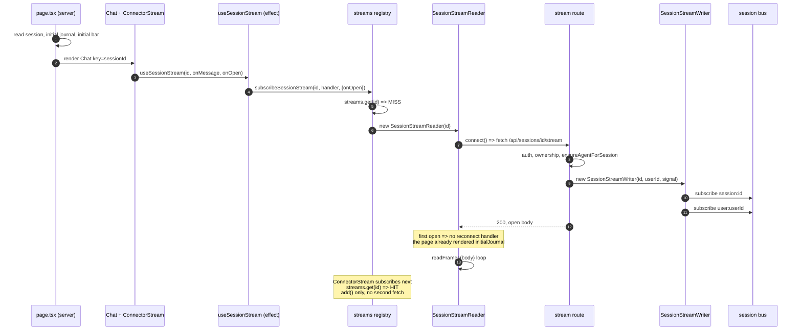
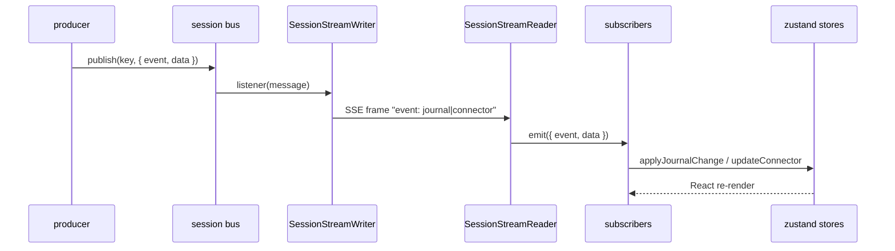
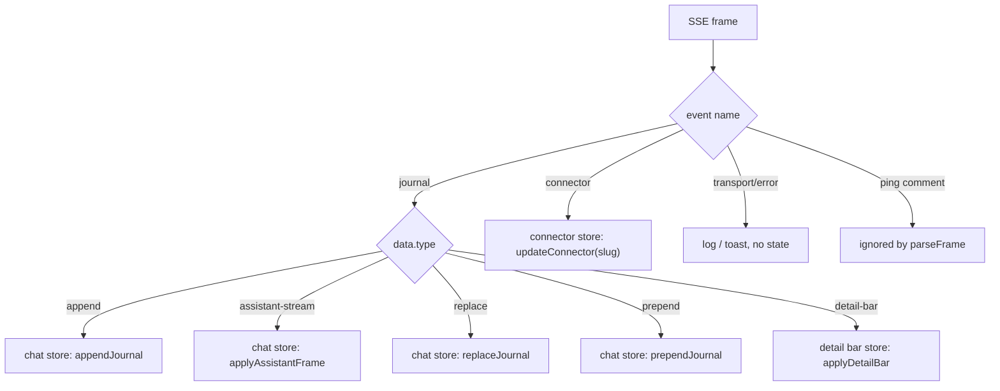
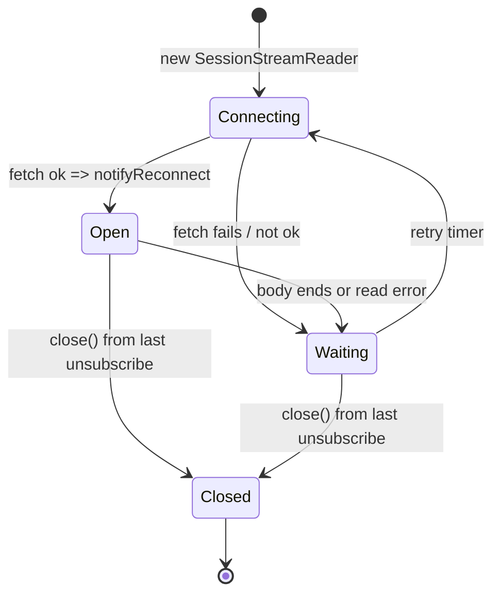
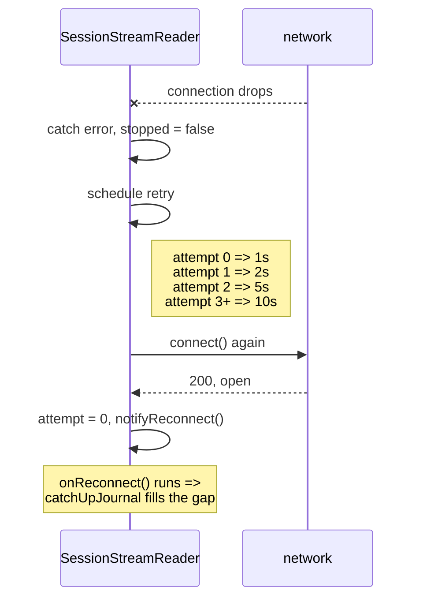
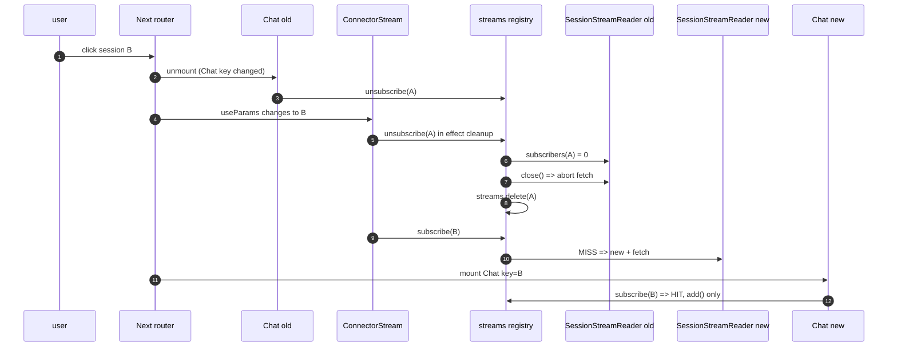
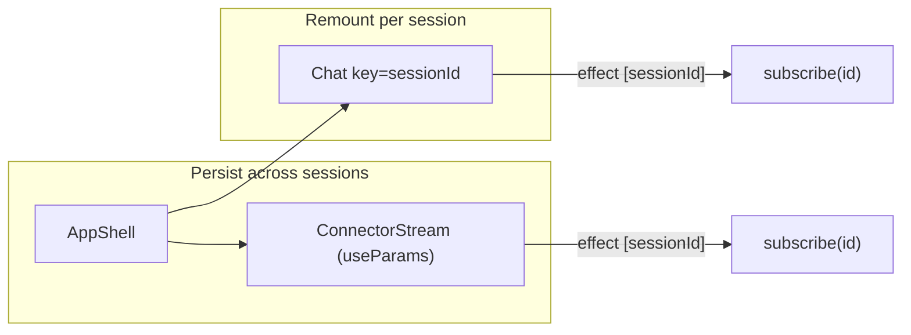

# Session Stream — Flows

One socket per session, shared by every consumer.

| param | name | runs where |
|---|---|---|
| 1 | `sessionId` | registry key, then `fetch("/api/sessions/<id>/stream")` |
| 2 | `onMessage` | inside `emit()`, for every SSE frame received |
| 3 | `onReconnect` | inside `notifyReconnect()`, only when a connection is **restored**: failed-then-retry, reconnect, or re-open after close. Skipped on the first open. |

---

## 1. First hit on a session

---

## 2. Mid-connection: a frame arrives

Frame dispatch on the client:

---

## 3. Mid-connection: the socket drops

If `close()` wins the race (`stopped = true`): abort controller, clear retry timer, no reconnect.

---

## 4. Switching sessions (client navigation)

React ordering: cleanups for the old tree run before effects for the new one, so no two sockets coexist beyond a single commit.

---

## 5. React mount rules

- `Chat` remounts on every session change because of `key={session.id}` → cleanup unsubscribes, effect subscribes.
- `ConnectorStream` stays mounted; `useParams()` changes → same effect cleanup/subscribe.
- `useSessionStream` effect deps are `[sessionId, Boolean(onOpen)]`; the callbacks live in refs, so re-renders never resubscribe.
- Last unsubscribe of a session → `close()` + `streams.delete(id)`.
